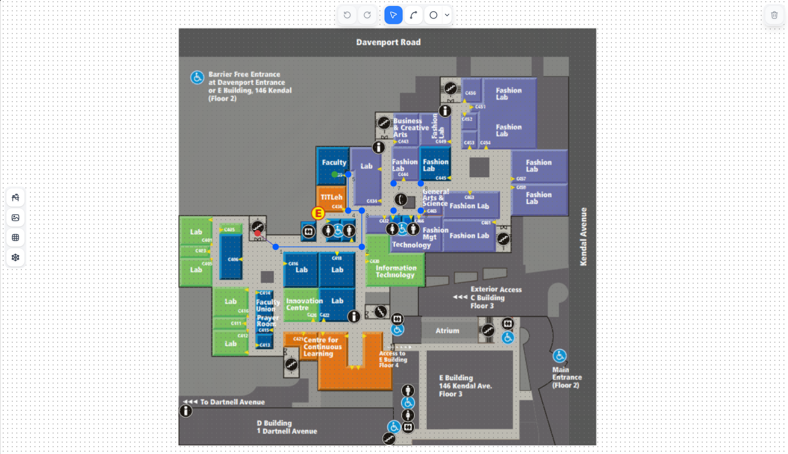
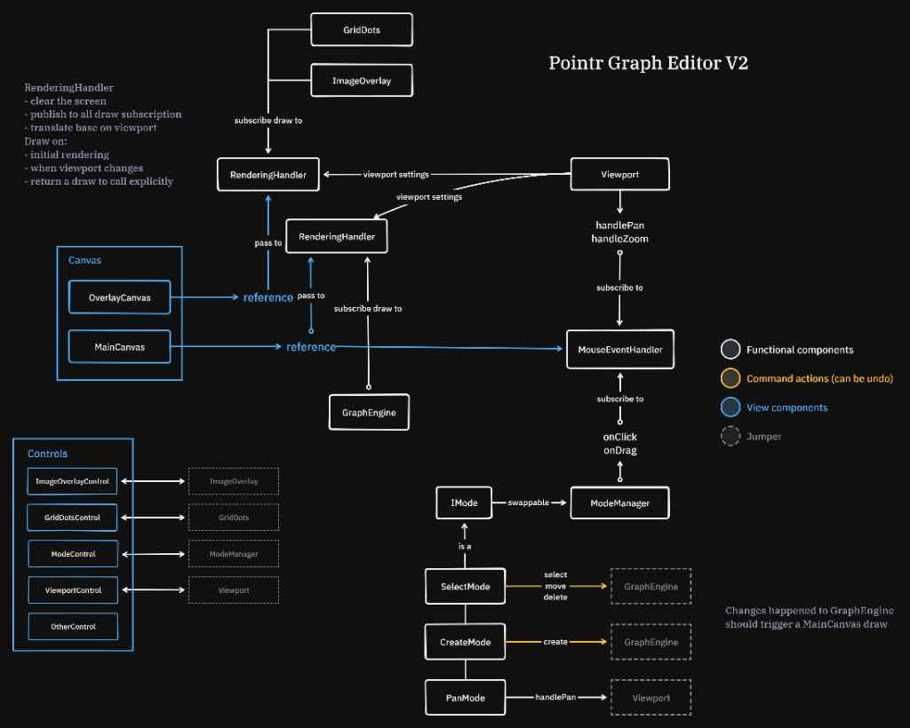

# Pointr Graph Editor

A web-based graph editor for **Pointr**, an open-source indoor navigation AR project. Drop in an indoor map, draw a path graph on top of it, and export to Neo4j.



Built with React, TypeScript, and Vite.

## Quick start

```bash
npm install
npm run dev
```

| Script | Description |
|--------|-------------|
| `npm run dev` | Start dev server |
| `npm run build` | Production build |
| `npm run test` | Run Jest tests |
| `npm run lint` | ESLint |

## Architecture



High-level design for **Pointr Graph Editor V2**. Legend:

- **White** — functional components (rendering, viewport, modes, graph engine)
- **Blue** — view components (canvas layers, controls)
- **Yellow** — undoable command actions (`select`, `move`, `delete`, `create`)
- **Dashed** — jumpers (references to components defined elsewhere)

### Rendering

Each canvas layer owns a `RenderingHandler` that clears the screen, applies viewport transforms, and publishes draw calls to subscribers (`GraphEngine`, `GridDots`, `ImageOverlay`, etc.). Graph changes trigger a redraw on `MainCanvas`.

### Input & modes

`Viewport` handles pan/zoom. `MouseEventHandler` forwards click and drag events to `ModeManager`, which swaps `IMode` implementations:

| Mode | Action |
|------|--------|
| **Select** | select, move, delete nodes/edges |
| **Create** | place new nodes |
| **Pan** | pan the viewport |

Mutations go through the **Command** pattern for undo/redo.

### Project layout

```
src/
├── components/   # Canvas layers & UI controls
├── core/commands/# Undoable mutations (ICommand)
├── domain/       # Graph entities & interaction modes
├── hooks/        # Rendering bus, event bus, attachments
├── stores/       # Zustand state (graph, canvas, commands)
└── services/     # Persistence & Neo4j export
```

## Tech stack

React 19 · TypeScript · Vite · Zustand · Tailwind CSS v4 · Framer Motion · Jest
